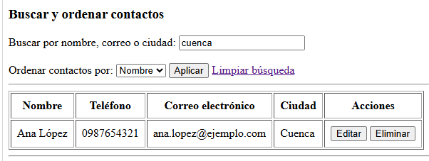
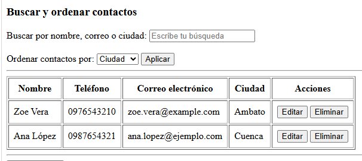

# Agenda Personal de Contactos

## Descripción

Aplicación web desarrollada para la asignatura Desarrollo Web de la
Universidad Técnica Particular de Loja (UTPL).

El sistema permite registrar usuarios y administrar una agenda personal
de contactos mediante PHP y MySQL.

Cada usuario puede gestionar únicamente sus propios contactos.

Esta segunda versión incorpora nuevas funcionalidades de búsqueda
y ordenamiento, además del despliegue en un hosting gratuito.

## Aplicación publicada

La aplicación se encuentra disponible en Internet:

https://agenda-contactos-utpl.site.je

## Repositorio de GitHub

Código fuente del proyecto:

https://github.com/mksijn/agenda_contactos

## Tecnologías utilizadas

- HTML5
- PHP 8
- MySQL / MariaDB
- PDO para la conexión con la base de datos
- JavaScript para confirmar la eliminación de contactos
- XAMPP para el desarrollo local
- Git y GitHub para el control de versiones
- InfinityFree como servicio de hosting gratuito

## Funcionalidades principales

- Registro de usuarios con correo electrónico único.
- Almacenamiento de contraseñas mediante password_hash().
- Inicio de sesión mediante password_verify().
- Protección de páginas privadas mediante sesiones PHP.
- Visualización de contactos del usuario autenticado.
- Registro de nuevos contactos.
- Edición de contactos existentes.
- Eliminación de contactos con confirmación.
- Validación de formularios en el servidor.
- Consultas preparadas mediante PDO.
- Verificación de propiedad de los contactos.
- Protección CSRF en operaciones sensibles.
- Cierre de sesión.

## Mejoras respecto a la versión anterior

### Mejora A. Búsqueda de contactos

Se incorporó un formulario de búsqueda que permite localizar
contactos mediante los siguientes campos:

- Nombre.
- Correo electrónico.
- Ciudad.

La búsqueda admite coincidencias parciales y muestra únicamente
los contactos del usuario autenticado.

También se incorporó la opción de limpiar la búsqueda.

### Mejora B. Ordenamiento de contactos

Se incorporó un selector que permite organizar los contactos por:

- Nombre.
- Ciudad.

El ordenamiento es alfabético y puede utilizarse junto con
la funcionalidad de búsqueda.

Ambas mejoras fueron comprobadas en el entorno local y en InfinityFree.

## Capturas de pantalla

### Búsqueda de contactos

La siguiente captura muestra la búsqueda de contactos por ciudad.

### Ordenamiento de contactos

La siguiente captura muestra los contactos ordenados por ciudad.

## Requisitos para la instalación local

- Servidor web Apache.
- PHP 8 con extensiones PDO y pdo_mysql.
- MySQL o MariaDB.
- Navegador web.
- XAMPP o un entorno equivalente.

## Instrucciones de instalación local

### 1. Obtener el proyecto

Descargar el repositorio de GitHub y copiar la carpeta
agenda_contactos dentro del directorio htdocs de XAMPP.

Ejemplo en Windows:

C:\xampp\htdocs\agenda_contactos

### 2. Iniciar los servicios

Abrir XAMPP Control Panel e iniciar:

- Apache.
- MySQL.

### 3. Crear la base de datos

Abrir phpMyAdmin:

http://localhost/phpmyadmin/

Crear una base de datos llamada:

agenda_contactos

Seleccionar la base de datos creada e importar
el archivo agenda_contactos.sql.

Este script crea las tablas usuarios y contactos.

### 4. Configurar la conexión

Dentro de la carpeta config, copiar el archivo:

conexion.ejemplo.php

Renombrar la copia como:

conexion.php

Editar conexion.php y configurar:

- Servidor de MySQL.
- Nombre de la base de datos.
- Usuario de MySQL.
- Contraseña de MySQL.

Utilizar las credenciales correspondientes a la instalación local.

El archivo conexion.php no se incluye en GitHub para evitar
publicar credenciales privadas.

### 5. Ejecutar la aplicación

Abrir en el navegador:

http://localhost/agenda_contactos/

Registrar una cuenta para comenzar a utilizar el sistema.

## Despliegue en hosting gratuito

La aplicación fue publicada en InfinityFree.

Para el despliegue se realizaron las siguientes actividades:

1. Crear una cuenta de hosting gratuito.
2. Configurar un subdominio público.
3. Crear una base de datos MySQL en InfinityFree.
4. Importar el archivo agenda_contactos.sql.
5. Subir los archivos PHP al directorio htdocs.
6. Configurar la conexión MySQL del hosting.
7. Comprobar el funcionamiento de la aplicación.

Se verificaron el registro, inicio de sesión, creación,
edición y eliminación de contactos, así como las mejoras
de búsqueda y ordenamiento.

## Seguridad

La aplicación utiliza sesiones PHP para identificar a los usuarios.

Las contraseñas se almacenan mediante funciones de hash.

Las consultas sobre contactos verifican el identificador
del usuario autenticado para impedir accesos no autorizados.

Se utilizan consultas preparadas y tokens CSRF para reforzar
la seguridad de las operaciones.

## Estructura del proyecto

- index.php: panel principal, búsqueda y ordenamiento.
- registro.php: registro de usuarios.
- login.php: inicio de sesión.
- logout.php: cierre de sesión.
- nuevo_contacto.php: creación de contactos.
- editar_contacto.php: edición de contactos.
- eliminar_contacto.php: eliminación de contactos.
- agenda_contactos.sql: estructura de la base de datos.
- config/conexion.ejemplo.php: plantilla de conexión.
- capturas/busqueda.PNG: evidencia de búsqueda.
- capturas/ordenamiento.PNG: evidencia de ordenamiento.

## Consideraciones

Proyecto desarrollado con fines académicos para la asignatura
Desarrollo Web de la Universidad Técnica Particular de Loja.

La aplicación puede ejecutarse localmente mediante XAMPP
o utilizarse desde su dirección pública en InfinityFree.
